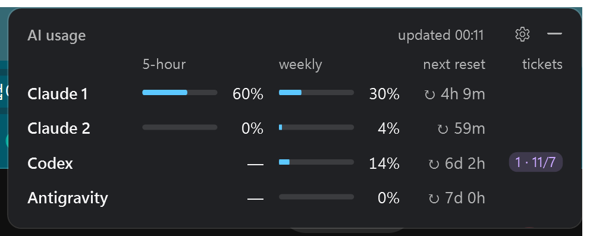
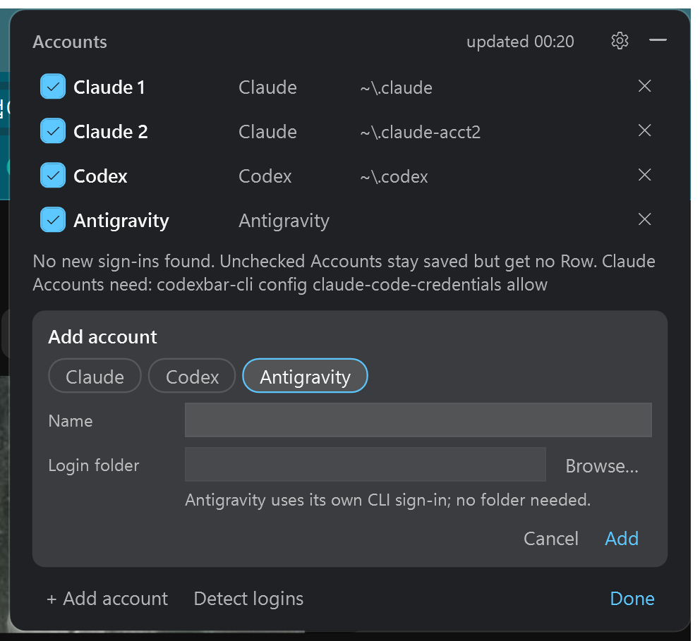

# Usage Widget

Claude, Codex, Antigravity(Gemini) 구독 계정의 사용량과 Gemini API 호출 수를 한눈에 보여주는 Windows·macOS 데스크톱 위젯입니다. 바탕화면에 붙인 메모처럼 떠 있습니다.



## 설치

[Releases](../../releases)에서 내 컴퓨터에 맞는 zip을 받습니다. 처음 실행하면 로그인된 계정을 자동으로 찾습니다.

### Windows

1. zip을 원하는 곳에 압축을 풉니다. 예: `%LOCALAPPDATA%\Programs\UsageWidget`
   - `win-x64-standalone`: 그대로 실행됩니다.
   - `win-x64`: [.NET 10 Desktop Runtime](https://dotnet.microsoft.com/download/dotnet/10.0)이 필요합니다.
2. `UsageWidget.exe`를 실행합니다.
3. (선택) 위젯을 우클릭하고 **Start with Windows**를 켭니다.

SmartScreen 경고가 뜨면 **추가 정보 → 실행**을 누릅니다. 서명되지 않은 앱이라 뜨는 경고입니다.

### macOS

1. Apple Silicon(M1 이상)은 `macos-arm64`, Intel Mac은 `macos-x64` zip을 받아 풉니다.
2. `Usage Widget.app`을 **응용 프로그램** 폴더로 옮기고 엽니다.
3. "확인되지 않은 개발자" 경고가 뜨면 **시스템 설정 → 개인정보 보호 및 보안**에서 **그래도 열기**를 누릅니다. 서명되지 않은 앱이라 처음 한 번만 필요합니다.
4. Claude 로그인을 읽을 때 "security이(가) 키체인을 사용하려고 합니다" 창이 뜨면 **항상 허용**을 누릅니다. Claude Code가 로그인을 키체인에 저장하기 때문입니다.
5. (선택) 위젯을 우클릭하고 **Start at login**을 켭니다.

## 필요한 것

- Windows 10/11 x64, 또는 macOS 15 이상
- 각 서비스의 CLI 로그인: `claude`(Claude Code), `codex`(ChatGPT 계정으로 로그인), `agy`(Antigravity CLI 1.1.11 이상)
- Gemini API 행: [Google Cloud SDK](https://cloud.google.com/sdk/docs/install)에 `gcloud auth login`으로 로그인하고, 해당 project에서 Cloud Monitoring API를 켭니다.

## 화면 보는 법

| 칸 | 내용 |
| --- | --- |
| 5-hour | 막대는 5시간 창 사용률, 숫자는 리셋까지 남은 시간 |
| weekly | 주간 사용률 (70% 주황, 90% 빨강) |
| weekly reset | 주간 리셋까지 남은 시간 |
| tickets | Codex 리셋 티켓 수 · 가장 빠른 만료일 |
| Gemini API | 오늘 / 이번 달 요청 수. **Balance ↗**를 누르면 브라우저로 AI Studio 결제 페이지(충전 잔액)가 열립니다 |

- 행에 마우스를 올리면 정확한 %, 리셋 시각, 플랜 등 자세한 내용이 나옵니다.
- 이름 옆에 `!`가 붙고 행이 흐려졌다면 마지막 읽기가 실패한 것입니다. 이때는 직전 값을 보여 줍니다. 원인은 마우스를 올리면 나옵니다.
- 배경을 클릭하면 바로 새로고침하고, 끌면 위젯이 이동합니다. 자동 새로고침은 5분마다 합니다.

## 띄우기와 숨기기

- **`Ctrl+Alt+Shift+U`** (Mac: **`⌃⌥⇧U`**): 위젯을 맨 앞으로 띄웁니다. 이미 맨 앞에 있으면 숨깁니다.
- 헤더의 **—** 버튼으로 숨기고, 작업 표시줄 버튼(Mac: Dock 아이콘)으로 다시 엽니다.
- 단축키는 ⚙에서 바꿀 수 있습니다. **Shortcut** 칸을 클릭하고 원하는 조합을 누르면 됩니다. **Clear**를 누르면 단축키를 끕니다.

## 계정 관리 (⚙)



- **체크박스**: 행을 보이거나 숨깁니다. 숨긴 계정은 읽지 않지만 설정은 남습니다.
- **✕**: 계정을 지웁니다.
- **+ Add account**: 이름, 서비스, 로그인 폴더를 넣어 추가합니다. Gemini API는 로그인 폴더 대신 Google Cloud project id를 넣습니다.
- **Detect logins**: 이 컴퓨터의 로그인을 찾아 추가합니다. 이미 있는 계정은 건너뜁니다. `GEMINI_API_KEY`가 설정돼 있으면 그 키가 속한 project도 추가합니다.

### 같은 서비스의 두 번째 계정

CLI는 폴더 하나에 로그인 하나를 저장합니다. 폴더를 지정해 로그인한 뒤 그 폴더를 위젯에 추가하거나 **Detect logins**를 누릅니다.

```
set CLAUDE_CONFIG_DIR=%USERPROFILE%\.claude-acct2
claude
```

```
set CODEX_HOME=%USERPROFILE%\.codex-work
codex login
```

## 설정 파일

Windows는 `%APPDATA%\UsageWidget\settings.json`, Mac은 `~/Library/Application Support/UsageWidget/settings.json`입니다. 위젯을 끈 상태에서 직접 고칠 수 있습니다.

| 키 | 기본값 | 의미 |
| --- | --- | --- |
| `refreshMinutes` | `5` | 새로고침 간격(분) |
| `showAnnouncements` | `true` | Codex 전체 리셋 예고를 Codex 행 아래에 표시 |
| `hotkey` | `Ctrl+Alt+Shift+U` | 띄우기/숨기기 단축키. Mac에서 `Win`은 ⌘입니다. `""`이면 끔 |
| `accounts` | 자동 감지 | 계정 목록(`name`, `provider`, `env`, `hidden`) |

파일이 깨져 있으면 `settings.json.broken`으로 보관하고 자동 감지한 계정으로 시작합니다. 시작 오류는 같은 폴더의 `error.log`에 남습니다.

## 데이터와 개인정보

- 사용량은 이 컴퓨터에 이미 있는 로그인으로, 각 서비스의 공식 앱이 쓰는 곳에서 직접 읽습니다. 토큰은 그 토큰을 발급한 서비스에만 보냅니다.
- Cloud Monitoring을 뺀 나머지 주소는 공개 문서가 없는 내부 API라서 바뀔 수 있습니다. 바뀌면 해당 행만 `!`로 표시됩니다. ([ADR 0003](docs/adr/0003-read-providers-directly.md))
- Claude 로그인이 만료되면 Claude Code와 같은 방식으로 갱신해서 같은 곳(Windows는 파일, Mac은 키체인)에 저장합니다. 그래서 Claude Code 로그인은 유지됩니다. 저장할 수 없으면 갱신하지 않습니다.
- Mac에서 Codex 로그인을 키체인에 저장하도록 설정했다면 그 계정은 읽지 못합니다. 기본 설정(`auth.json` 파일)은 읽습니다.
- Codex 리셋 예고는 비공식 공개 피드 `https://codex-resets.com`에서 가져옵니다. 끄려면 `showAnnouncements: false`로 설정합니다.

Anthropic, OpenAI, Google과 관계없는 개인 프로젝트입니다.

## 직접 빌드

.NET 10 SDK가 필요합니다.

```
dotnet test tests/UsageWidget.Tests
dotnet run --project src/UsageWidget
powershell -File tools/publish.ps1   # 테스트 후 Windows 배포 zip을 artifacts/release에 만듦
bash tools/package-macos.sh arm64    # Mac에서 .app zip을 만듦 (x64도 가능)
```

## 라이선스

[MIT](LICENSE)
